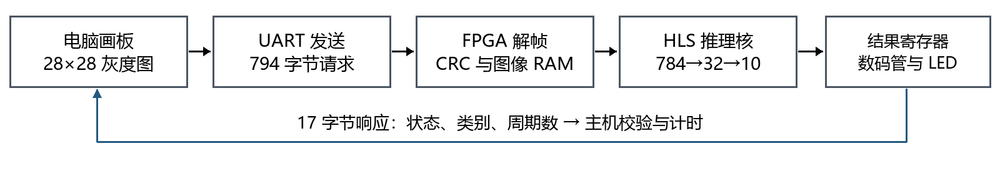
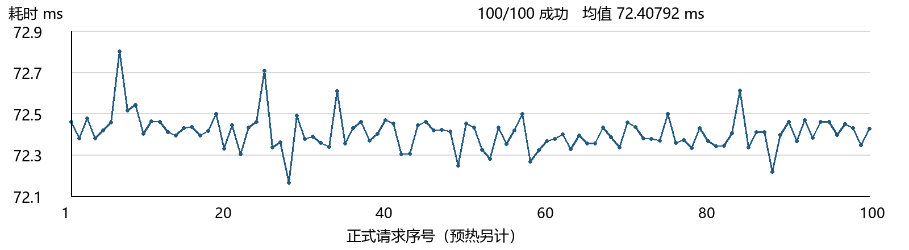

# 实验三手写数字识别 FPGA 系统实验报告

本实验完成了全连接网络训练、定点化、HLS 推理核及串口识别系统。完整 MNIST 测试集定点准确率为 96.60%；板上固定 100 图测试全部成功，平均端到端耗时 72.40792 ms。本文记录截至 2026 年 10 月 27 日的证据；三速优化实测和正式现场验收尚待完成。

| 项 | 内容 |
|---|---|
| 课程 | 高层次综合技术应用与实验（2026 秋） |
| 实验名称 | 实验三 手写数字识别的 AI 部署 |
| 署名人及学号 | 黄成 26011211112 |
| 小组成员 | 黄成 26011211112；贺孟文 26011211132；张逸帆 26011211104；党钰晋 26011211341 |
| 班级及指导教师 | 待填写 |
| 验收日期 | 待教师现场填写 |
| 工程位置 | D:\HLS\code\exp3 |

## 1 实验目的与任务

实现黑底白字的 28×28 手写画板，经 USB 转 UART 将图像送入 FPGA，在板上完成神经网络推理、数码管与 LED 显示，并返回可逐帧统计的结果。通过完整测试集数值比对、错误帧恢复和实际通信计时，检验模型部署的正确性与可用性。

模型采用 784→32→10 全连接结构。预设目标为浮点准确率不低于 96%、定点不低于 95%、相对精度下降小于 1%；工作时钟 50 MHz，DSP 预算不超过 60，推理核延迟不超过 250000 周期。端到端性能以主机实际计时为准，不用 HLS 估计值代替板测。

验收按训练与仿真 50 分、硬件实测 50 分组成，现场成绩占总评 60%，报告占 40%。本文保持模板规定的八部分、八页结构；完整 AI 日志、声明及验收表分别附后，不预填教师成绩和签名。

<!-- pagebreak -->
## 2 原理简述

浮点计算为 h=ReLU(W1·x+b1)，z=W2·h+b2，其中 x=p/256，p 为灰度像素。预测取 z 最大分量的下标；省略 softmax 不改变分类结果。网络含 25408 个权重和 42 个偏置，共 25450 个参数。

权重采用 int8，小数位 fw1=fw2=6；隐藏激活采用 uint8，小数位 fh=4；偏置与累加采用 int32。第一层计算 A1=B1q+ΣW1q·p，其中 B1q 按 2^14 缩放。隐藏输出为 Hq=clip(floor((max(A1,0)+512)/1024),0,255)。第二层 Zq=B2q+ΣW2q·Hq，B2q 按 2^10 缩放；所有类别尺度一致，可以直接比较。

像素先扩展为 9 位有符号正数再与权重相乘，防止 128–255 被误解为负数；乘积为 17 位，累加为 32 位，舍入临时值加宽至 33 位。对每个神经元计算 |bias|+255Σ|weight|，第一层最大界限 2245808、第二层 207348，均小于 2^31−1；该论证覆盖任意 uint8 输入，不仅覆盖测试样本。

| 协议字段 | 取值及设计理由 |
|---|---|
| 帧头 | A5 5A；为字节流重新寻找帧起点 |
| 版本与类型 | 01；请求 01、响应 81，拒绝不支持的消息 |
| 序号与长度 | 各 16 位小端；请求载荷固定 784 字节 |
| CRC | CRC16 CCITT-FALSE；初值 FFFF、多项式 1021，覆盖版本至载荷 |
| 响应载荷 | 状态、类别、flags 各 1 字节，核心周期数 4 字节 |

请求总长 794 字节，响应 17 字节；8N1 每字节占 10 个线路位。按标称波特率，顺序传输时间 T_wire=8110/baud 秒。主机首次写请求前记录 t0，完整响应校验通过后记录 t1，识别时间为 t1−t0。CRC 检错、序号匹配、长度限制与接收超时共同防止错误数据被当作有效识别。

权重由训练文件导出为 weights.h 常量，经 HLS 综合为 ROM 与计算电路，再与 UART、缓存和显示模块一起生成 bit。用户通过 JTAG 下载的是含权重初始化内容的硬件配置；FPGA 无需运行 PyTorch，也不在板上训练。当前为易失性下载，断电后需重新配置。

<!-- pagebreak -->
## 3 设计与实现



图 1　系统模块与数据流。图像载荷为 784×8 bit，RAM 地址为 10 bit，分类为 4 bit；推理核使用 ap_start/ap_done 握手。结果同步送往串口响应及显示模块。

训练固定 seed=2026，将训练数据按已保存索引划分为 55000/5000；batch=128、Adam 学习率 0.001、20 个 epoch。最佳验证准确率为 95.72%，出现在第 20 轮。训练集 6000 张用于校准，验证集在 fh=2/3/4 中选择 fh=4，冻结模型后评估完整 10000 张测试集。

选择小型全连接网络满足简单模型的要求，减少旧工具链的调度复杂度。权重映射 BRAM，乘加单元分时复用，未完全展开 784 次乘法。该方案仅用 2 个 DSP；完全展开会提高带宽和资源需求，而当前端到端时间主要受串口影响。

关键 HLS 指令和数据操作摘录如下，完整实现见 hls/nn_infer.cpp：

```cpp
#pragma HLS INTERFACE ap_memory port=image
#pragma HLS RESOURCE variable=W1 core=ROM_1P_BRAM
#pragma HLS PIPELINE II=1
ap_int<9> value = pixels[i];
ap_int<17> product = value * W1[j][i];
sum += score_t(product);
```

PIPELINE 位于内层乘加循环，目标 II=1；顶层仍需完整遍历所有神经元。控制器在 CRC 通过后启动推理，忙时禁止覆盖图像 RAM，等待响应发完再接收下一帧；核心设 20 ms 看门狗。

GUI 采用黑底白笔，按阈值 16 裁出前景，最长边缩放至 20 像素，放回 28×28 并做灰度重心居中，以减少书写位置与大小变化。空白输入不发送。正式 MNIST 测试使用原始像素；GUI 几何处理的诊断结果另列，避免混淆统计口径。

<!-- pagebreak -->
### AI 协作过程与工程验证

任务先给出目录、实验要求、器件与预算，再要求形成方案并执行；用户明确保留全部硬件操作。AI 负责编码和非硬件工具运行，用户负责下载、串口测试及反馈。日志逐项记录输入上下文、产出、验证和修改归属；工具调用不计作新的用户交互。

| 过程 | 提供的信息与决策 | 可核验结果 |
|---|---|---|
| T2 上下文包 | 原始资料、FC 模型要求、硬件边界 | 执行文档与验收门槛 |
| T3 工程实现 | 固定环境、脚本化训练与构建 | Python 30 项、RTL 8 套通过 |
| T4 量化迭代 | 位宽、误差及溢出预算 | fh=4；定点 96.60% |
| T4 性能迭代 | 同源核关闭/开启 MAC 流水线 | 51730→26364 周期 |
| T5 显示排错 | 只有数字 4 正常 | 段序修复；用户确认正常 |
| T5 串口排错 | 2553/2560 字节、四灯锁定 | FIFO 扩容后 2560 字节一致 |
| T3 板测反馈 | COM7、100 图命令与原始 CSV | 100/100 成功；参考不一致 0 |

量化轮先提出 int8 权重、uint8 激活及 int32 累加，再用验证准确率和整数上界检查。性能轮先提出低并行流水线，再用同源 HLS 综合与协同仿真比较。两轮均有方案和验证证据，但发生在 Agent 自主执行过程中，不能包装成四次独立的用户优化对话。

附件日志整理截至本次文档请求的 16 条历史用户请求或反馈，另有本次身份及心得补充 1 条；E01–E16 是执行子事件，单独计数。原始模板要求 T2≥1、T3≥3、T4≥4、T5≥2；总轮次数量不能替代分类要求，尤其 T4 的独立交互配额尚不能由现有材料证明。首次直接可用比例因缺乏统一交付样本定义记为 N/A；人工改代码记录为 0，AI 自身修复不冒充人工修改。

验证从 Python 协议和定点单元测试，推进到 HLS C 全集比对、24 样本协同仿真，再到真实推理 RTL 的串口整机闭环。独立回环测试采用不同输入位周期，补上同源收发器测试遗漏的速率差场景。发布过程检查完成标记、时序和哈希，避免旧工具批处理退出码为零时误判成功。

数码管段线采用低有效 {dp,g,f,e,d,c,b,a}；数字 0–9 编码为 C0、F9、A4、B0、99、92、82、F8、80、90。物理最右位编号仍需现场单独确认。工程使用 Vivado/HLS 2018.3、C++03 和 Python 3.12；实际工具路径与命令见 README。

<!-- pagebreak -->
## 4 实验结果

| 完整 MNIST 测试集 | 样本数 | 正确数 | 准确率 |
|---|---|---|---|
| 浮点 PyTorch | 10000 | 9657 | 96.57% |
| Python 整数参考 | 10000 | 9660 | 96.60% |
| 实际综合 HLS C | 10000 | 9660 | 96.60% |

定点比浮点高 0.03 个百分点；以 max(浮点−定点,0) 定义的精度损失为 0，满足预设门槛。该单次结果不能推广为量化必然提升准确率。Python 与 HLS C 的 10000 个类别及 100000 个得分全部一致；24 样本 RTL 协同仿真全部匹配，覆盖每类两张和四种特殊图案。

| HLS 核版本 | Latency | 顶层 Interval | LUT | FF | BRAM18 | DSP |
|---|---|---|---|---|---|---|
| 关闭 MAC 流水线 | 51730 | 51731 | 556 | 242 | 18 | 2 |
| 开启 MAC 流水线 | 26364 | 26365 | 594 | 232 | 18 | 2 |

表中 Latency 和 Interval 单位均为周期；内层 MAC 的 II=1 不等于顶层 Interval=1。开启流水线使综合核心延迟降低 49.04%，由 1.03460 ms 降至 0.52728 ms。该对照解释计算优化，不能代替端到端优化板测。

| 整机实现 | LUT | FF | BRAM36 | DSP | WNS ns |
|---|---|---|---|---|---|
| baseline 115200 | 552 | 627 | 9.5 | 2 | +1.855 |
| medium 230400 | 551 | 627 | 9.5 | 2 | +2.417 |
| fast 460800 | 552 | 627 | 9.5 | 2 | +2.608 |

三组均满足 20 ns 时钟约束，保持裕量分别为 +0.052、+0.059、+0.093 ns。HLS BRAM18 与整机 BRAM36 的单位、统计边界不同；18 个 BRAM18 等效 9 个 BRAM36，整机还含接口缓存。当前 baseline 占 50 块 BRAM 的 19%，DSP 为 2/90；课程的 DSP≤60 继续作为更严格的预算。

全测试激活饱和为 499/320000=0.1559375%，高于 0.1% 软目标，已保留偏差；数值一致性和精度硬门槛通过。GUI 几何诊断准确率 94.55% 不等同于用户手写准确率。原始数据位于 evidence/training、simulation 和 implementation；本次文档复核纠正了旧草稿把顶层 Interval 写成 Latency 的问题。

<!-- pagebreak -->
### 板上结果与识别时间分析

用户在 COM7、115200 下完成 10 帧预热及 100 帧正式测试。原始 CSV 的图像哈希、标签、参考类别、序号、CRC 与发布清单已逐项复核：100/100 成功，分类正确 100/100，参考不一致 0；该结论只覆盖本批固定图片。回环另有 2560 字节逐字节一致证据。



图 2　板上固定 100 图端到端实测曲线，10 帧预热不计入。均值 72.40792 ms，中位数 72.4034 ms，P95 72.5151 ms，范围 72.1651–72.8033 ms；失败数为 0。原始目录：evidence/timing/board_20261027_101021_105065。

全部响应返回 26365 个核心周期，按 50 MHz 为 0.5273 ms。标称线路时间 70.3993 ms，约占均值 97.23%；核心约占 0.73%，差额约 1.4813 ms。线路时间是按波特率估算，核心来自板上计数；差额包含 USB、调度、解析及估算误差，不能拆称独立测量值。

| 优化对照 | 115200 基线 | 230400 候选 | 460800 候选 |
|---|---|---|---|
| 线路估算 ms | 70.3993 | 35.1997 | 17.5998 |
| 现有板测平均 ms | 72.40792（100帧） | 待板测 | 待板测 |
| 正式各300帧均值/P95 | 待板测 | 待板测 | 待板测 |
| 对基线实际降幅 | 基准 | 待板测 | 待板测 |

三组需用同一模型、前 100 张图各重复 3 次、预热 10 次比较，并保留失败；选定配置再做 1000 帧稳定性测试。现阶段尚未满足“至少一项端到端优化实测”的要求，不能把理论提速或核级综合降幅填成板测收益。

手写日志另有 13 次成功请求、早期 3 次超时，全部缺真实标签且固件身份为 unknown，故不计算手写准确率，也不替代连续 5 次现场考核。数码管正常已获用户确认；物理最右位、GUI与显示同帧照片、错包恢复及教师验收仍待补录。

<!-- pagebreak -->
## 5 问题与解决

问题一：数码管只有 4 正常。对照原理图逐脚核验后，确认程序误将段序反向解释；4 的 0x99 在位反转后不变，符合现象。建立独立物理段形测试，旧版 9 失败、1 通过；修正全部段码与自检后 10 项通过，重建比特流，用户反馈显示正常。教训是测试期望不能照抄实现常量，必须由引脚和段形独立推导。

问题二：串口回环只收到 2553/2560 字节，四灯锁定。LED 对应 FIFO 溢出标志；独立串口输入仿真在 8605 ns 位周期下复现相同丢 7 字节现象，帧错误为 0。原 16 字节 FIFO 不足以容纳持续突发的收发速率差积压，扩为 128 字节后，四种位周期、各 2560 字节均通过；用户复验 2560 字节完全一致。教训是同频仿真不能覆盖独立时钟偏差，有限 FIFO 也不能保证无限长快入慢出流不溢出。仿真位周期未当作板上实测。

问题三：HLS 数值验证通过，但 IP 导出报 bad lexical cast。日志中的 core_revision 日期编码超过旧工具有符号整数范围。仅复制本工程生成的打包脚本并将 Revision 改为 1，再执行打包，保留原脚本及哈希；没有改动模型或推理 RTL。教训是数值正确、RTL 正确和工具打包成功必须分别检查。

## 6 总结与心得

这次实验使我认识到，模型部署需要把训练结果转化为具有明确位宽、接口和时序的电路。参数量和准确率只能说明模型的一部分特性；是否能在 FPGA 上稳定运行，还取决于量化误差、存储映射、通信协议和实际引脚约定。

两次上板故障说明，具体反馈比笼统描述更有助于定位。“只有 4 正常”和“少 7 字节且四灯常亮”分别指向段序和 FIFO 积压，也暴露了原测试的覆盖不足。今后我会优先核验测试依据是否独立，并保存失败记录，而不是只保留最终通过结果。

基线测量还表明，核心计算约 0.53 ms，而端到端约 72.41 ms，优化应先针对主要耗时环节。后续应完成高波特率对照、带标签的手写测试及错误帧恢复，再依据数据选定最终配置。以上心得由 AI 按实际过程起草，须由署名人核对并形成自己的最终表述。

<!-- pagebreak -->
## 7 AI 使用声明

姓名及学号：黄成，26011211112。实验：实验三手写数字识别的 AI 部署。小组成员：黄成、贺孟文、张逸帆、党钰晋。

| 工具及版本 | 使用范围 | 大致占比口径 |
|---|---|---|
| Codex；具体模型版本未核验 | 方案、主体代码、脚本执行、故障分析、报告及心得初稿 | 主体代码与本文初稿由 AI 生成；无统一总工时占比记录 |

AI 编写主体代码并执行训练、仿真、综合、布局布线和归档。用户提供要求与现场反馈，亲自下载并操作串口及板卡。未记录人工改代码；AI 修复不计为人工修改，总工时占比未计量。

技术正文及第 6 节按本人请求由 AI 起草，尚待本人核对与签署；完整使用点及确认原文见附件《AI使用声明》。现场按实验三检查点验收，不预填问答成绩或个人掌握程度。

本人确认：以上声明属实。我理解本实验的设计决策、关键代码与结果数据，并能独立解释。

签名：________________　日期：________________

## 8 附录

工程为 D:\HLS\code\exp3。训练与量化见 train、common；推理核 hls/nn_infer.cpp；顶层 rtl/exp3_top.v；上位机 host/gui.py；构建 scripts/build.py。运行及硬件步骤见 README 和 docs/硬件操作与验收清单.md。

| 附件或证据 | 内容与定位 |
|---|---|
| AI交互日志.docx | 真实交互、两轮执行迭代、配额及可靠性分析 |
| AI使用声明.docx | 工具使用清单、个人审阅与签名 |
| 实验三验收记录表.docx | 八项评分、待测记录与教师签字栏 |
| 提交说明与要求核对.md | 文件清单、原要求映射、未完成项 |
| evidence/board/report_audit_20261027.json | 原始 CSV、图像、回环与哈希复核 |

原始模板未覆盖。模型与 bit 身份见量化配置及发布清单；主机 bit 哈希来自所选文件，不是设备回读。补齐优化实测、现场照片和签字后，重新检查页数再提交。
